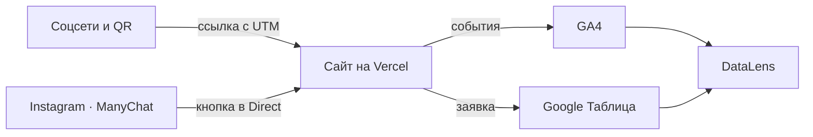

# Описание работы · ТЗ № ___ · «___»

<!--
Скопируйте этот файл в репозиторий проекта как docs/opisanie.md.
Текст уже написан: замените ___ своими данными, а кадры положите по указанным путям.
Пример заполнения — по ТЗ-01, скалодром «Кварцит».
Имена кадров — примеры, можно взять свои из screens/. Такие комментарии перед сдачей удалите.
-->

**Исполнитель:** ___, группа ___
**Сайт:** https://___.vercel.app
**Период проверок:** ___ — ___

## 1. Задача заказчика

Компания «___» получает заявки из ___, но не знает, какой канал приводит
клиентов. В ___ было ___ обращений, потеряно ___ (письмо директора в ТЗ).
Задача — сайт, на котором видно источник каждого посетителя, и одна
таблица со всеми заявками.

## 2. Схема работы

Посетитель приходит из соцсетей или по QR-коду по ссылке с UTM-метками.
Сайт отправляет события в GA4, а заявку — в Google Таблицу через Apps Script.
Данные GA4 и таблицы собираются на дашборде DataLens.

<!-- Схему можно взять со страницы 3 ТЗ или нарисовать. Ниже готовый вариант на Mermaid: оставьте его или удалите. -->

Схема на Mermaid

## 3. Сайт

Сайт из ___ страниц создан с помощью ___ и доработан вручную: ___.
Опубликован на Vercel, обновляется после каждого push.

## 4. Аналитика GA4

Настроено ___ событий, из них своих — ___. Ключевые события: ___.
Каждое событие проверено в DebugView.

## 5. UTM-ссылки и соцсети

В реестре ___ ссылок, опубликованы в ___ (Instagram, ВКонтакте, Telegram,
YouTube), у двух партнёров и на афише с QR-кодом.

## 6. Заявки

Форма отправляет заявку в Apps Script, тот проверяет поля и записывает
строку в лист `leads` вместе с метками. Повторная отправка не создаёт дубль.

## 7. Автоответы в Instagram

Комментарий «___» под Reel запускает ответ в комментариях и сообщение
в Direct с кнопкой на сайт. Вторая ветка — слово «___».

## 8. Отчёты и дашборд

Воронка показала наибольшую потерю между ___ и ___ (___ %).
Больше всего заявок принёс канал ___.

## 9. Что получил бизнес

| Было | Стало |
|---|---|
| заявки в личных сообщениях трёх аккаунтов | все заявки в одной таблице со статусом |
| источник клиента неизвестен | у каждой заявки есть source, medium, campaign |
| бюджет делится «по ощущениям» | на дашборде видно заявки по каждому каналу |
| ответы на комментарии вручную | ManyChat отвечает сразу и ведёт на сайт |

Рекомендация заказчику: ___ (по данным из раздела 8).

## 10. Итог

Не получилось: ___
ИИ использовался для: ___
