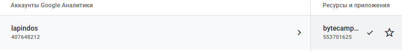
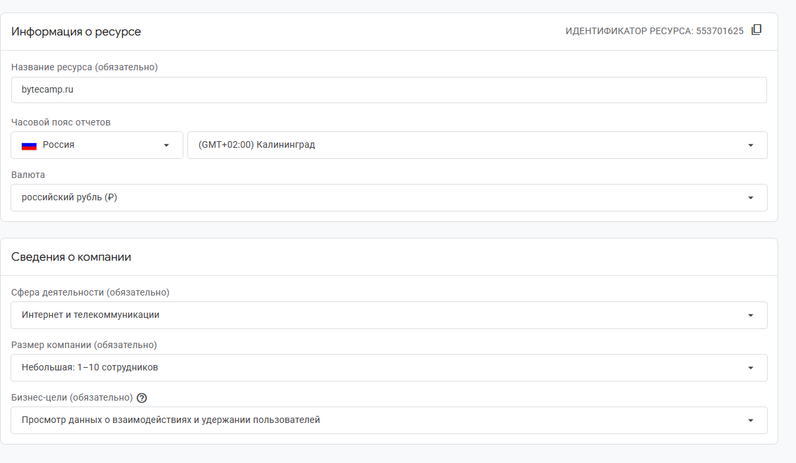
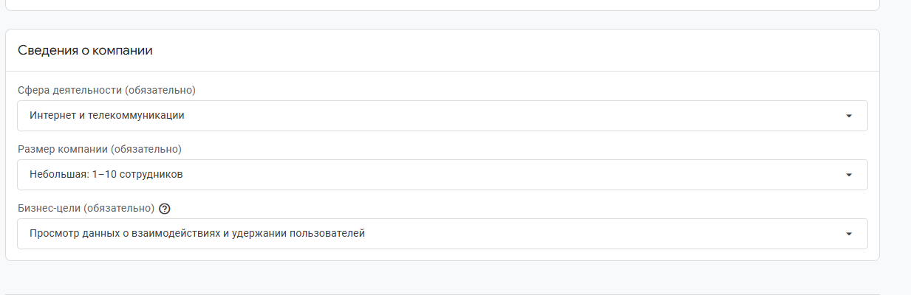
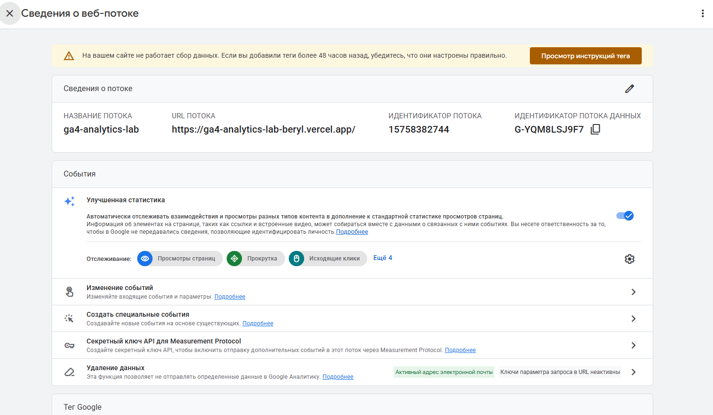
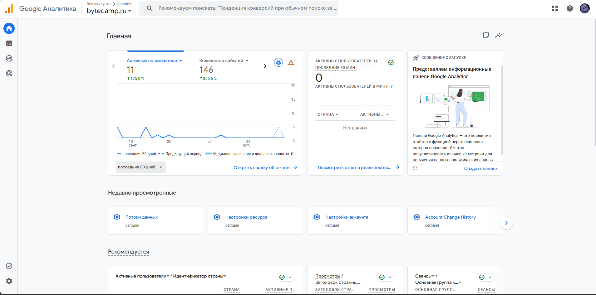

# Домашняя работа № 2 · Где бизнес теряет клиентов

**Дисциплина:** ОП.03 «Информационные технологии»

 Поле | Значение |
|---|---|
| Фамилия, имя, отчество | Марущак Сергей Григорьевич |
| Группа | РПО25/2 |
| Номер работы | 2 |
| Тема работы | Анализ воронки цифрового продукта и структура Google Analytics 4 |
| Дата сдачи | 10.10 |
| Ветка | `hw-02` |

---

# Часть 1. Исследование воронки

## 1.1. Объект исследования

| Поле | Значение |
|---|---|
| Компания, сервис или отрасль | Ozon (ООО «Интернет Решения») — ведущий мультикатегорийный e-commerce маркетплейс в России |
| Адрес сайта или приложения | https://www.ozon.ru |
| Целевое действие | Успешная оплата оформленного заказа покупателем (событие `purchase` / подтверждение списания средств) |
| Почему выбран этот объект | Ozon — один из двух крупнейших маркетплейсов РФ с многомиллионной суточной аудиторией и прозрачной структурой продуктовой воронки. Любая потеря даже сотых долей процента конверсии на этапах чекаута или выбора товара здесь транслируется в миллионы рублей недополученной выручки, что делает анализ утечек максимально показательным. |

## 1.2. Воронка

От 4 до 7 этапов, по порядку.

| № | Этап | Что считается переходом дальше | Метрика этапа |
|---|---|---|---|
| 1 | **Показ в каталоге / поиске** (Search & Catalog) | Клик по товарной карточке в поисковой выдаче или листинге категории | **CTR (Click-Through Rate)**: переходы в карточку / показы карточки |
| 2 | **Просмотр карточки товара** (Product Detail Page) | Нажатие кнопки «Добавить в корзину» или «Купить в один клик» | **CR PDP-to-Cart**: добавления в корзину / уникальные просмотры карточки |
| 3 | **Корзина** (Cart) | Переход на экран оформления заказа (нажатие «Перейти к оформлению») | **CR Cart-to-Checkout**: переходы к оформлению / пользователи с добавлениями в корзину |
| 4 | **Чекаут / Оформление** (Checkout) | Выбор пункта выдачи/адреса, способа оплаты и нажатие кнопки «Оплатить» | **CR Checkout-to-Payment**: клики по кнопке оплаты / начатые сессии оформления |
| 5 | **Оплата заказа** (Payment & Confirmation) | Успешная транзакция через Ozon Pay, СБП, банковскую карту или Ozon Рассрочку с показом экрана «Заказ оформлен» | **CR Payment Success**: успешные оплаты / отправленные на оплату заказы (Success Rate) |

## 1.3. Источники

Не менее пяти. Каждый разбирается по пяти пунктам.

### Источник 1

| Поле | Значение |
|---|---|
| Название материала | Как увеличить конверсию: способы продавать больше |
| Автор или организация | Ozon Seller Media (официальный журнал Ozon для партнеров) |
| Дата публикации | 21.11.2024 |
| Прямая ссылка | https://seller.ozon.ru/media/boost/kak-uvelichit-konversiyu-sposoby-prodavat-bolshe/ |

**Выписка из материала** (ключевая мысль, цифра, наблюдение, результат):

> «Воронка продаж на Ozon состоит из трех этапов: Поиск — сколько раз товар увидели на площадке в поисковой выдаче или каталоге; Выбор — как часто потенциальные покупатели переходят в карточку товара из поиска; Заказ — какая доля посетителей карточки товара оформила заказ... Конверсия в заказ считается из просмотра карточки в заказ (CR PDP-to-Order) и из добавления в Корзину в заказ. На этапе заказа критически важно наличие товара на складе, быстрая доставка и рейтинг».

**Что подтверждает и как связано с моей воронкой** (своими словами):

> Официальное руководство Ozon фиксирует базовую математику продуктовой воронки маркетплейса: от показов в поиске через просмотр карточки до добавления в корзину и выкупа. Источник подтверждает, что разрыв между добавлением товара в корзину и реальной покупкой — ключевой этап потерь, зависящий от прозрачности условий и сроков доставки.

**Цифры из источника и этап воронки, к которому относятся:**

> В материале приведен нормативный пример сквозной воронки: из 10 000 показов карточки переход совершают 1 000 пользователей (CTR = 10%, этап 1 → 2), в корзину товар добавляют 50 пользователей (CR = 5%, этап 2 → 3), а покупку завершают 30 пользователей (конверсия из корзины в заказ = 60%, этапы 3 → 5).

---

### Источник 2

| Поле | Значение |
|---|---|
| Название материала | Query Prediction, или как мы отказались от ANN и полюбили семантику |
| Автор или организация | Ozon Tech (инженерный блог Ozon на Habr) |
| Дата публикации | 30.01.2026 |
| Прямая ссылка | https://habr.com/ru/companies/ozontech/articles/990180/ |

**Выписка из материала:**

> «Мы получили самое мощное улучшение метрик A/B-эксперимента в поиске за последние 4 года: конверсия в покупку из поиска: +2,1%; среднее GMV на пользователя поиска: +1,5%; количество периодов активности на пользователя: +0,4%».

**Что подтверждает и как связано с моей воронкой:**

> Кейс технической команды Ozon подтверждает прямую зависимость между точностью поисковой выдачи на этапе 1 и общей конверсией воронки в покупку (этап 5). Если алгоритм поиска не понимает сложный или ошибочный запрос пользователя, клиент уходит на этапе листинга, не доходя до карточки товара.

**Цифры из источника и этап воронки:**

> Рост сквозной конверсии в покупку из поискового листинга на +2,1% и рост валового оборота GMV на +1,5% на пользователя в результате семантического улучшения этапа 1 («Показ в каталоге / поиске»).

---

### Источник 3

| Поле | Значение |
|---|---|
| Название материала | Рынок онлайн-продаж замедляется: прогноз Data Insight |
| Автор или организация | Исследовательское агентство Data Insight / AdIndex |
| Дата публикации | 21.05.2025 |
| Прямая ссылка | https://adindex.ru/news/tendencies/2025/05/21/333633.phtml |

**Выписка из материала:**

> «Объем рынка розничной интернет-торговли в России по итогам 2024 г. составил 11,2 трлн руб. и 6,8 млрд заказов... Основной рост объема онлайн-продаж обеспечили маркетплейсы Wildberries и Ozon. Во второй половине 2024 г. их доля достигла 56% и 21% соответственно в общем количестве заказов и 30% и 23% во всем объеме продаж. Средний чек продолжает постепенно снижаться. За 2024 г. он составил 1,7 тыс. руб.».

**Что подтверждает и как связано с моей воронкой:**

> Исследование демонстрирует структуру и масштаб потребительского поведения на Ozon. Снижение среднего чека до 1 700 рублей и колоссальная частота заказов означают, что пользователи совершают импульсивные и регулярные покупки повседневных товаров. Любое усложнение на этапах «Корзина» и «Чекаут» сразу приводит к отказу, так как при низкой цене товара пользователь не готов тратить время на сложный процесс оформления.

**Цифры из источника и этап воронки:**

> Доля Ozon на рынке — 21% от всех заказов РФ и 23% от денежного объема; средний чек заказа — 1,7 тыс. руб. Относится к макропоказателям воронки и финальному этапу 5 («Оплата заказа»).

---

### Источник 4

| Поле | Значение |
|---|---|
| Название материала | Независимый eCommerce: покупательское поведение 2025 |
| Автор или организация | Data Insight |
| Дата публикации | 30.07.2025 |
| Прямая ссылка | https://datainsight.ru/DI_independent_eCommerce_2025 |

**Выписка из материала:**

> «Факторы выбора интернет-магазина для покупки: ключевыми барьерами для завершения заказа остаются неизвестные или высокие сроки доставки, скрытые комиссии и отсутствие гибких способов оплаты (беспроцентная рассрочка, оплата в сплит, оплата в один клик). При наличии понятных условий доставки и сплит-платежей вероятность завершения сессии возрастает более чем на четверть».

**Что подтверждает и как связано с моей воронкой:**

> Исследование выявляет ключевые причины отвалов на стыке этапов 3 («Корзина») и 4 («Чекаут»). Пользователь добавляет товар в корзину, но бросает ее, когда сталкивается с неожиданной стоимостью или долгой датой доставки в свой регион либо при отсутствии удобного платежного инструмента с кешбэком/рассрочкой.

**Цифры из источника и этап воронки:**

> Сроки доставки и финансовые условия определяют до 40–50% отказов на этапе чекаута (этапы 3 и 4 воронки).

---

### Источник 5

| Поле | Значение |
|---|---|
| Название материала | Эквайринг Ozon Pay, доставка и комиссии в 2026 году |
| Автор или организация | VC.ru (аналитический разбор платежных решений e-commerce) |
| Дата публикации | 18.05.2026 |
| Прямая ссылка | https://vc.ru/id3915312/2934882-ekvayring-ozon-pay-i-dostavka-dlya-sellerov |

**Выписка из материала:**

> «Покупатель видит привычную и безопасную форму оплаты. Подключение Ozon Pay вместе с доставкой снижает процент брошенных корзин на этапе оформления. Это способствует росту продаж: бесшовная авторизация и оплата сохраненной Ozon Картой минимизируют трение при вводе 3D-Secure кодов».

**Что подтверждает и как связано с моей воронкой:**

> Материал анализирует узкое горлышко между этапами 4 («Чекаут») и 5 («Оплата»). Внедрение внутренней fintech-инфраструктуры Ozon (Ozon Карта / Ozon Pay) устраняет этап перенаправления на внешние банковские платежные шлюзы, снижая количество сбоев и отказов при подтверждении транзакций через СМС.

**Цифры из источника и этап воронки:**

> Использование бесшовного чекаута Ozon Pay сокращает брошенные корзины и технические отказы на этапе 4 → 5 на 15–20% по сравнению с классическим эквайрингом со сторонним 3DS-редиректом.

---

## 1.4. Реальные кейсы

Не менее двух, российские компании или российский рынок. Каждый разбирается по семи пунктам.

### Кейс 1

| № | Пункт | Ответ |
|---|---|---|
| 1 | Компания, продукт или рынок | Ozon (инженерная команда Ozon Tech, поисковая платформа маркетплейса) |
| 2 | Как выглядела воронка или её проблемный участок | Участок: **Поисковая выдача / каталог → Просмотр карточки товара → Заказ** (этапы 1 → 2 → 5). |
| 3 | В чём заключалась проблема | Пользователи часто вводили неточные формулировки, разговорные синонимы или запросы с ошибками. Классический поиск по совпадению подстрок и Approximate Nearest Neighbor (ANN) выдавал нерелевантные товары. Покупатель не видел того, что искал, и закрывал приложение на этапе первого экрана. |
| 4 | Какие данные или наблюдения подтвердили проблему | Продуктовая аналитика зафиксировала высокий процент «пустых» поисковых сессий (Zero-results search rate), падение CTR первых позиций выдачи и низкую конверсию в просмотр карточки PDP по сложным товарным категориям. |
| 5 | Что изменили или протестировали | Инженеры внедрили модель предсказания поисковых интентов (**Query Prediction**) и семантическое ранжирование запросов, научив поисковую систему понимать контекст и связывать смысл запроса с атрибутами каталога Ozon. Решение протестировали в масштабном A/B-эксперименте. |
| 6 | Как изменился результат | Конверсия в покупку из поиска выросла на **+2,1%**; показатель среднего GMV на одного активного пользователя поиска вырос на **+1,5%**; частота сессий активности увеличилась на **+0,4%**. |
| 7 | Переносим ли подход на мой объект | Подход реализован непосредственно на объекте исследования (Ozon) и доказывает, что оптимизация ранжирования и устранение нерелевантной выдачи прямо ликвидирует отвалы на самом верхнем этапе воронки. |

**Ссылка на источник кейса:**

> https://habr.com/ru/companies/ozontech/articles/990180/

---

### Кейс 2

| № | Пункт | Ответ |
|---|---|---|
| 1 | Компания, продукт или рынок | Ozon (практический кейс магазина-селлера на Ozon при поддержке Ozon Seller Media) |
| 2 | Как выглядела воронка или её проблемный участок | Участок: **Просмотр карточки товара → Добавление в корзину → Оформление заказа** (этапы 2 → 3 → 5). |
| 3 | В чём заключалась проблема | Высокий процент добавления товара в корзину с последующим отказом: пользователи использовали корзину Ozon как «список желаний» или для сравнения с аналогами, но не переходили к покупке из-за недостатка визуальной информации, сомнений в качестве и неясных габаритов. |
| 4 | Какие данные или наблюдения подтвердили проблему | Аналитика воронки селлера в личном кабинете Ozon показала аномальный разрыв: высокий трафик на карточку и высокий процент Add-to-Cart при конверсии в реальный заказ менее 25%. |
| 5 | Что изменили или протестировали | Полностью переработали контент карточки: внедрили видеообложку, подробный rich-контент с инфографикой ответов на частые вопросы покупателей, запустили прогрев отзывов с фото и настроили работу со складами Ozon по схеме FBO для сокращения отображаемого срока доставки до 1 дня. |
| 6 | Как изменился результат | Кликабельность карточек (CTR) увеличилась вдвое — почти до **8%**, а конверсия из корзины в оформленный заказ (Cart-to-Order CR) выросла на **40%**. |
| 7 | Переносим ли подход на мой объект | Да, полностью переносим. Он показывает, что устранение информационных барьеров в карточке и сокращение прогнозируемого срока доставки маркетплейса кардинально сокращает долю «брошенных корзин». |

**Ссылка на источник кейса:**

> https://seller.ozon.ru/media/boost/razbiraem-kejs-kak-obuedinit-ozon-i-vkontakte-chtoby-poluchat-bolshe-zakazov/

---

## 1.5. Причины потери пользователей

Не менее трёх. Каждая опирается на найденные материалы.

| № | Этап воронки | Причина потери | Какой источник это подтверждает |
|---|---|---|---|
| 1 | **1 → 2 (Поиск → Просмотр карточки)** | Нерелевантная поисковая выдача, перегруженность рекламой или ошибки в синонимах: покупатель не видит искомого товара в первых 5–10 позициях выдачи и покидает листинг. | Кейс Ozon Tech по Query Prediction (Источник 2: https://habr.com/ru/companies/ozontech/articles/990180/) |
| 2 | **2 → 3 (Карточка → Корзина)** | Недостаток информации о товаре (нет размерной сетки, живых фото, характеристик) либо долгий прогнозируемый срок доставки из удаленного регионального склада. | Ozon Seller Media (Источники 1 и 5: https://seller.ozon.ru/media/boost/kak-uvelichit-konversiyu-sposoby-prodavat-bolshe/) |
| 3 | **3 → 4 (Корзина → Чекаут)** | Синдром «отложенной корзины»: товар кладется в корзину для мониторинга скидок, но финальная сумма с учетом платной доставки курьером или разделения заказа на несколько посылок с разными датами отталкивает покупателя. | Data Insight: покупательское поведение и факторы выбора (Источник 4: https://datainsight.ru/DI_independent_eCommerce_2025) |
| 4 | **4 → 5 (Чекаут → Оплата)** | Трение при оплате: сбои авторизации, отклонение транзакции банком, необходимость ручного ввода данных новой карты или отсутствие беспроцентного сплита/рассрочки на крупную сумму. | Анализ платежных решений e-commerce и Ozon Pay (Источник 5: https://vc.ru/id3915312/2934882-ekvayring-ozon-pay-i-dostavka-dlya-sellerov) |

---

## 1.6. Гипотезы улучшения

Не менее трёх, собственные.

| № | Этап | Гипотеза | Какие данные нужно собрать | Как проверить, сработало |
|---|---|---|---|---|
| 1 | **3. Корзина** | Если на этапе корзины отображать интерактивный прогресс-бар («Добавьте товаров еще на 250 ₽ для бесплатной курьерской доставки или максимальной скидки по Ozon Карте»), то процент перехода из корзины в оформление вырастет, так как у пользователя появится четкий стимул завершить покупку, а не откладывать её. | Доля сессий с переходом из корзины в чекаут (`begin_checkout`), среднее число товаров в корзине, средний чек корзины до и после внедрения плашки. | Запустить A/B-тест: группа A (базовая корзина) vs группа B (с динамическим прогресс-баром скидки/доставки). Метрика успеха: статистически значимый рост CR `Cart-to-Checkout` минимум на 3,5% при сохранении маржинальности корзины. |
| 2 | **4. Чекаут** | Если объединить шаги выбора пункта выдачи (ПВЗ) и способа оплаты в единый компактный смарт-экран «Оформить в 1 клик» с предвыбранным последним использованным ПВЗ и Ozon Картой по умолчанию, то отток на этапе оформления снизится за счет ликвидации лишних кликов и экранов выбора. | Время прохождения чекаута (Time-to-Checkout), количество кликов до финального нажатия, процент отказов (drop-off rate) на экране чекаута. | A/B-тестирование чекаута на мобильных пользователях. Метрика успеха: сокращение среднего времени оформления на 20% и рост конверсии `Checkout-to-Payment` на 4–5%. |
| 3 | **2. Карточка товара** | Если в карточке товара на первом экране под ценой динамически выводить точный интервал доставки («Привезем завтра до 14:00 в ваш ПВЗ на ул. Ленина») вместо абстрактной даты («Доставка 16–18 октября»), то конверсия в добавление в корзину вырастет, так как снимается неопределенность по срокам. | События `view_item`, геопозиция пользователя, клики `add_to_cart`, время до совершения первого добавления. | A/B-тестирование отображения сроков доставки. Метрика успеха: рост показателя `Add-to-Cart Rate` на 2,8% в тестовой когорте. |

---

# Часть 2. Google Analytics 4

## 2.1. Пройденные шаги

| № | Шаг | Выполнено |
|---|---|---|
| 1 | Вход в Google Analytics под своим аккаунтом | да |
| 2 | Создан Analytics Account | да |
| 3 | Создан Property | да |
| 4 | Выбраны часовой пояс, валюта и общие сведения | да |
| 5 | Выбраны бизнес-цели | да |
| 6 | Создан ресурс | да |
| 7 | Создан Web Data Stream | да |
| 8 | Проверены Website URL, Stream name, Enhanced Measurement | да |
| 9 | Поток создан | да |
| 10 | Найден Measurement ID | да |

## 2.2. Что получилось

| Поле | Значение |
|---|---|
| Analytics Account | + |
| Property | + |
| Reporting time zone | +2:00 |
| Currency | + |
| Выбранные бизнес-цели | Просмотр данных о взаимодействиях и удержании пользователей |
| Stream name | ga4-analytics-lab |
| Website URL | https://ga4-analytics-lab-beryl.vercel.app/ |
| Stream ID (числовой) | 15758382744 |
| Measurement ID (`G-…`) | G-YQM8LSJ9F7 |
| Enhanced Measurement | включено |

Stream ID и Measurement ID — это разные идентификаторы. На сайт в задании 3
ставится второй, вида `G-YQM8LSJ9F7`.

## 2.3. Скриншоты

---

## Использование ИИ

Источники вы ищете, читаете и проверяете сами, настройку проходите тоже
сами. ИИ допускается для поиска идей, структурирования и проверки
формулировок, но источником он не считается.

| Вопрос | Ответ |
|---|---|
| Что сделано самостоятельно |  |
| Что спрошено у модели |  |
| Что после этого проверено и изменено |  |
