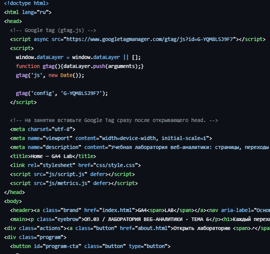
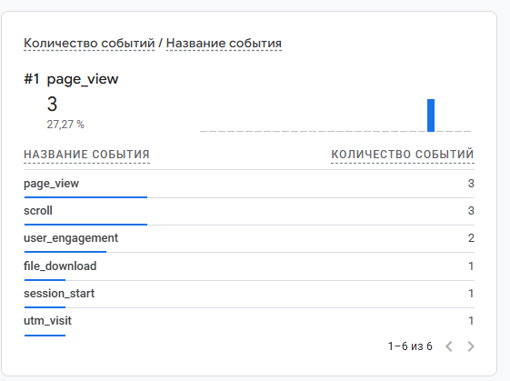
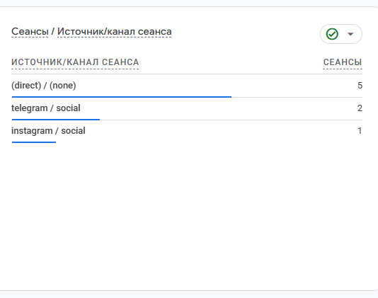

# Домашняя работа № 3 · Тег на сайте, источник и отчёты GA4

**Дисциплина:** ОП.03 «Информационные технологии»

| Поле | Значение |
|---|---|
| Фамилия, имя, отчество | Марущак Сергей Григорьевич |
| Группа | РПО25/2 |
| Номер работы | 3 |
| Тема работы | Установка Google Tag, источник перехода и отчёты GA4 |
| Дата сдачи | 25.10 |
| Ветка | `hw-03` |

---

## 1. Мой сайт и мой ресурс

| Поле | Значение |
|---|---|
| Адрес репозитория сайта | https://github.com/Lapindos/ga4-analytics-lab |
| Публичный адрес сайта | https://ga4-analytics-lab-beryl.vercel.app/ |
| Статус публикации | READY |
| Analytics Account |  |
| Property |  |
| Stream name | ga4-analytics-lab |
| Website URL в потоке | https://ga4-analytics-lab-beryl.vercel.app/ |
| Measurement ID (`G-…`) | G-YQM8LSJ9F7 |
| Страницы с тегом | `index.html`, `about.html`, `contacts.html`, `guide.html` |

Тег ставится на каждую страницу по одному разу: две копии дают двойные
события.

## 2. Тег установлен

**Результат проверки из инструкции тега:**

В карточке потока GA4 написано: «Сбор данных работает в течение последних 48 часов». Идентификатор потока `G-YQM8LSJ9F7`, адрес потока совпадает с адресом сайта.

Скриншот: вставьте строку ``



## 3. События доходят до аналитики

| Поле | Значение |
|---|---|
| Дата и время проверки | 25.10 |
| Какие страницы открывали | https://ga4-analytics-lab-beryl.vercel.app/ |
| Какие события появились в Realtime | `page_view` 3, `scroll` 3, `user_engagement` 2, `file_download` 1, `session_start` 1, `utm_visit` 1 |
| Число активных пользователей в момент проверки |  |



## 4. Источник перехода определился

Ссылка собирается с метками `utm_source`, `utm_medium`, `utm_campaign`
и открывается на своём сайте.

**Ссылка целиком:**

```
https://ga4-analytics-lab-beryl.vercel.app/?utm_source=telegram&utm_medium=social&utm_campaign=ga4_lab
```

| Поле | Значение |
|---|---|
| Где в GA4 виден источник | Отчёты, карточка «Сеансы / Источник/канал сеанса» |
| Какое значение источника показал GA4 | `telegram / social`, 2 сеанса |
| Совпадает с `utm_source` из ссылки | да |



Источник и кампания из UTM в отчёте Realtime не показываются: эти измерения
вычисляются при обработке данных. Если в Realtime источника нет, смотрите
отчёт по источникам трафика в разделе «Отчёты».

## 5. Статистика на странице «Отчёты»

| Показатель | Значение | Период |
|---|---|---|
| Пользователи |  |  |
| Сеансы |  |  |
| События |  |  |
| Самое частое событие |  |  |

Скриншот: вставьте строку ``

**Что видно по этим числам** (2–3 предложения):

>

## 6. Что не получилось

Если какой-то шаг не заработал, напишите какой, какое сообщение показал сервис
и что было проверено по таблице из `README.md`. Незаполненный раздел означает,
что всё получилось.

Кадр с фразой «На вашем сайте обнаружен тег Google» ещё не снят. Сводка «Отчёты» с числом пользователей и сеансов тоже не снята. Поток данные принимает: в Realtime есть `page_view`, в отчёте источников есть `telegram / social`.

## 7. Использование ИИ

Тег вы устанавливаете, проверяете и снимаете кадры сами. ИИ допускается
для формулировок и оформления.

| Вопрос | Ответ |
|---|---|
| Что сделано самостоятельно |  |
| Что спрошено у модели |  |
| Что после этого изменено |  |
