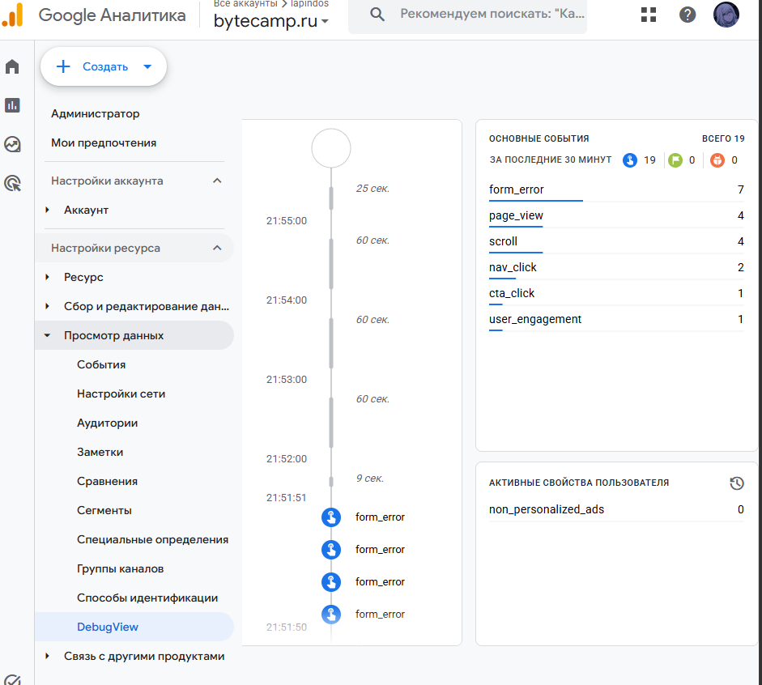

# Домашняя работа № 4 · Свои события и параметры в GA4

**Дисциплина:** ОП.03 «Информационные технологии»

| Поле | Значение |
|---|---|
| Фамилия, имя, отчество | Марущак Сергей Григорьевич |
| Группа | РПО25/2 |
| Номер работы | 4 |
| Тема работы | Свои события и параметры: четыре метрики на сайте |
| Дата сдачи | 25.10 |
| Ветка | `hw-04` |

---

## 1. Мой сайт и мой ресурс

| Поле | Значение |
|---|---|
| Публичный адрес сайта | https://ga4-analytics-lab-beryl.vercel.app/ |
| Measurement ID (`G-…`) | G-YQM8LSJ9F7 |
| Коммит с метриками (ссылка или первые 7 символов) | `3a6ac15` |
| Статус публикации | READY |
| Страницы, где подключён `js/metrics.js` | `index.html`, `about.html`, `contacts.html` |

Файл подключается после основного скрипта и на каждой странице по одному
разу: два подключения дают двойные события.

## 2. Какие метрики добавлены

| Событие | Что измеряет | Что делали, чтобы оно сработало |
|---|---|---|
| `nav_click` | клики по пунктам меню | нажимал пункты меню, в Realtime событие есть |
| `utm_visit` | метки кампании из адреса | открывал сайт по ссылке с UTM, в Realtime событие есть |
| `read_30s` | полминуты на странице | в видимой части списка Realtime этого события нет |
| `form_error` | форма не прошла проверку браузера | отправлял пустую форму, браузер её не пропускает |


## 3. События в DebugView

| Поле | Значение |
|---|---|
| Дата и время проверки | 25.10, около 21:51–21:55, последние 30 минут |
| Как подключали отладку | DebugView, всего 19 событий |
| Какие из четырёх событий пришли | `form_error` 7, `nav_click` 2. Рядом `page_view` 4, `scroll` 4, `cta_click` 1, `user_engagement` 1 |
| Какие не пришли и почему | `utm_visit` в ленте нет: страница в отладке открыта без меток в адресе. `read_30s` в списке тоже нет |



## 4. Параметры события `utm_visit`

**Ссылка, по которой открывали сайт:**

```

```

| Параметр | Значение в ссылке | Значение в GA4 |
|---|---|---|
| `utm_source` |  |  |
| `utm_medium` |  |  |
| `utm_campaign` |  |  |
| `landing_page` | — |  |

Скриншот: вставьте строку ``

Если значение в GA4 отличается от значения в ссылке, напишите, в чём разница
и почему так вышло.

>

## 5. Событие вне отладки

| Поле | Значение |
|---|---|
| Где проверяли | Realtime |
| Какое событие искали | `form_error` |
| Сколько срабатываний показал экран | 24 |
| Период (для отчёта) | последний час |


## 6. Что эти метрики показывают про сайт

Два-три предложения: что вы узнали о поведении посетителей из четырёх
новых событий. Например, по каким пунктам меню ходят чаще, доходит ли
кто-то до получаса чтения, спотыкается ли форма.

Сайт не даёт отправить пустую форму: за последние 30 минут DebugView записал `form_error` 7 раз. Клики по меню тоже доходят, `nav_click` сработал 2 раза. События `utm_visit` в этой ленте нет, потому что отладочное окно открыто без меток в адресе. `read_30s` за эти 30 минут не появился.

## 7. Что не получилось

Если какая-то метрика не заработала, напишите какая, что показывал экран
и что было проверено по таблице из `README.md`. Незаполненный раздел
означает, что всё получилось.

В DebugView за последние 30 минут нет `utm_visit` и `read_30s`. Кадр раскрытого `utm_visit` с параметрами ещё не снят: событие не попало в ленту. В Realtime раньше `utm_visit` был виден, 2 срабатывания за час.

## 8. Использование ИИ

Скрипты метрик выданы готовыми. Подключение, проверку и кадры вы делаете
сами. ИИ допускается для формулировок и оформления.

| Вопрос | Ответ |
|---|---|
| Что сделано самостоятельно |  |
| Что спрошено у модели |  |
| Что после этого изменено |  |
