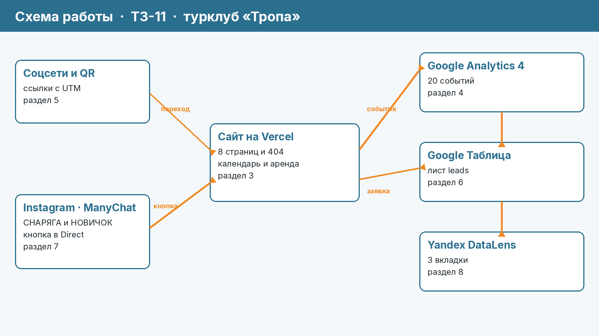

# Турклуб «Тропа» — сайт и сквозная аналитика броней

Курсовая работа по дисциплине ОП.03 «Информационные технологии», ТЗ № ТЗ-11/2026.
Исполнитель: Марущак Сергей Григорьевич, группа РПО25/2.

Сайт зимних походов: посетитель приходит по ссылке с метками, бронь с маршрутом, датой и источником падает в Google Таблицу, а руководитель видит каналы на дашборде.



## Что осталось подключить вам

GA4, таблицу, Vercel, соцсети, ManyChat и DataLens из этой среды не опубликовать: нужны ваши аккаунты. Код уже подготовлен по темам 4–7 и 9–10.2 курса. Порядок подключения — в [docs/podklyuchenie.md](docs/podklyuchenie.md). Какие кадры и документы снять после этого — в [docs/chto-snyat.md](docs/chto-snyat.md).

Два места в коде, куда вставляются ваши адреса:

| Куда | Что вставить |
|---|---|
| `<head>` всех HTML, сейчас `G-YQM8LSJ9F7` | Measurement ID нового ресурса «ТРОПА — сайт» |
| `action` формы в `contacts.html` | URL веб-приложения Apps Script, окончание `/exec` |
| `SPREADSHEET_ID` в `apps-script/Code.gs` | ID таблицы «Tropa — Bookings» |

`G-YQM8LSJ9F7` — идентификатор из домашних работ. Для приёмки ТЗ нужен отдельный ресурс, его подставляете вы.

## Ссылки

| Что | Ссылка |
|---|---|
| Сайт | публикуется на Vercel из этой папки, адрес появится после деплоя |
| Таблица заявок | создаётся по [docs/podklyuchenie.md](docs/podklyuchenie.md), лист `leads` |
| Дашборд DataLens | создаётся после накопления данных GA4 и таблицы |
| Instagram и Reel с автоответом | аккаунт проекта и Reel «Ночёвка в палатке при −15 °C», ключевые слова СНАРЯГА и НОВИЧОК |
| ВКонтакте · Telegram · YouTube | отдельные страницы компании, ссылки из [docs/utm.csv](docs/utm.csv) |
| Описание работы | [docs/opisanie.md](docs/opisanie.md) |
| Презентация к защите | [presentation/zashchita.pdf](presentation/zashchita.pdf) |

Ресурс GA4 в коде сейчас: `G-YQM8LSJ9F7` (учебный, его нужно сменить). Доступ Viewer к новому ресурсу «ТРОПА — сайт» выдаёте вы на e-mail преподавателя.

По ТЗ репозиторий проекта называется `tz-11-turklub-tropa`. Код лежит в этой папке. Если преподаватель ждёт отдельный репозиторий, перенесите содержимое папки в новый публичный репозиторий с этим именем. При деплое из текущего репозитория в Vercel укажите Root Directory: `tz-11-turklub-tropa`.

## Что сделано

| Часть | Результат |
|---|---|
| Сайт | 8 страниц и `404.html`, статический HTML, цвета и шрифты из раздела 2 ТЗ. Локальный Lighthouse главной в мобильном режиме: 99 / 100 / 100 |
| GA4 | тег в `<head>` каждой страницы, 18 обязательных событий и 2 по выбору (`promo_copy`, `map_open`), вызовы `gtag('event')` только в `js/analytics.js` |
| UTM | 12 ссылок в реестре, пять меток, якорь `#easy` после `?`, QR и афиша для U-12 |
| Заявки | форма → `fetch` → Apps Script → лист `leads`, проверка полей и повторного `request_id` |
| Instagram | тексты двух веток ManyChat собраны в инструкции, сам аккаунт подключаете вы |
| Отчёты | структура отчётов и записка подготовлены. Числа не подставлены: их ещё нет в вашем GA4 и DataLens |

## Технологии

HTML, CSS, JavaScript · Google Analytics 4 · Google Таблицы и Apps Script ·
ManyChat · Yandex DataLens · GitHub и Vercel. Сайт собран в Cursor
(запросы — в [docs/prompts.md](docs/prompts.md)).

## Структура

```text
index.html …         страницы сайта
js/analytics.js      все события GA4
js/form.js           бронь, UTM в sessionStorage, generate_lead после ok
apps-script/Code.gs  приёмник заявок и подготовка листов
docs/                описание, реестр UTM, события, записка, схема, подключение
screens/             кадры сайта; кадры GA4 и соцсетей снимаете вы
presentation/        презентация к защите
```

## Итог

Не получилось: опубликовать сайт на Vercel, создать ресурс GA4 «ТРОПА — сайт», таблицу, короткие ссылки, посты, ManyChat и дашборд DataLens — для этого нужны ваши аккаунты. Числа в аналитическую записку поэтому не вписаны.

Нейросеть использовалась для: вёрстки страниц, текстов по разделу 2 ТЗ, `js/analytics.js`, `js/form.js`, `apps-script/Code.gs`, схемы, реестра UTM и черновика презентации.
