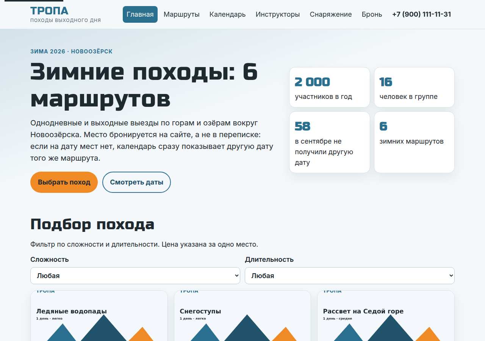
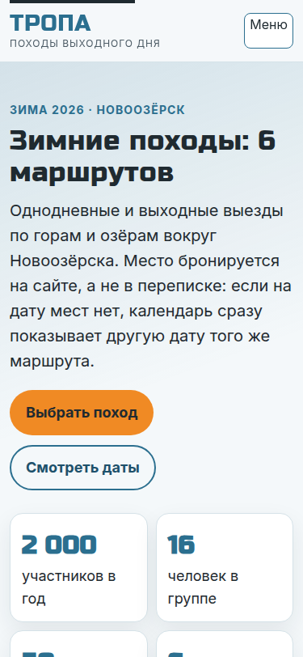
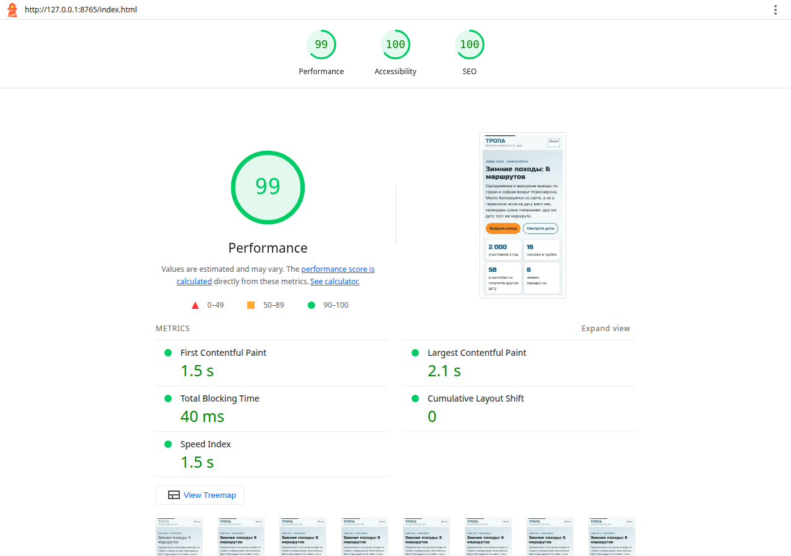
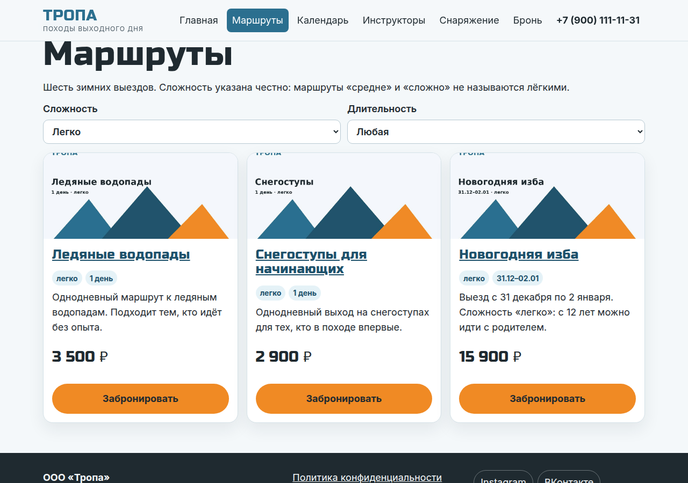
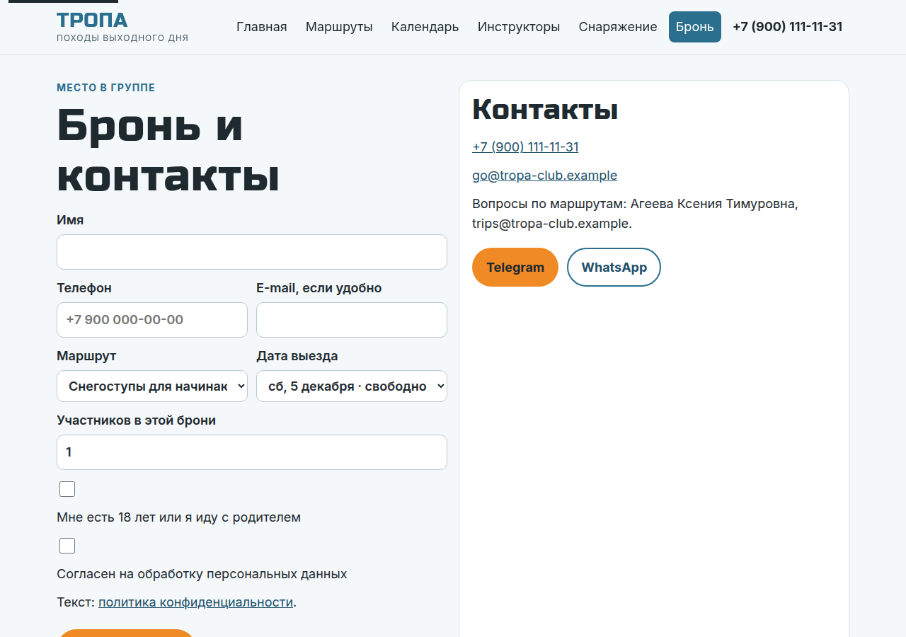
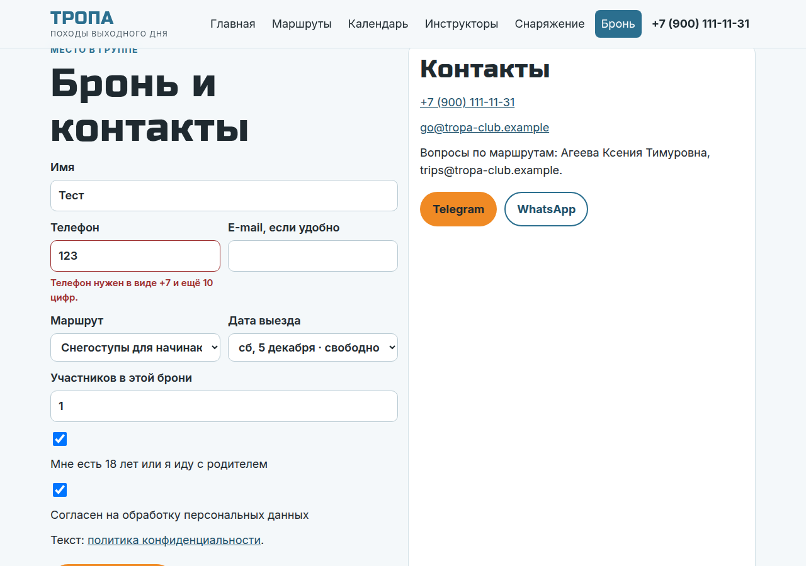
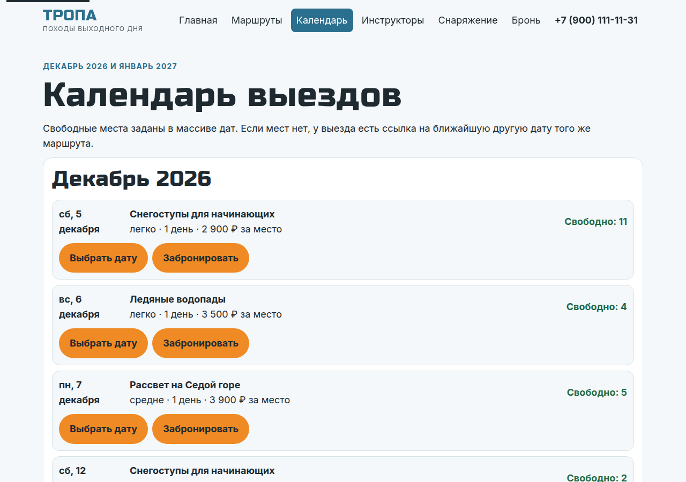
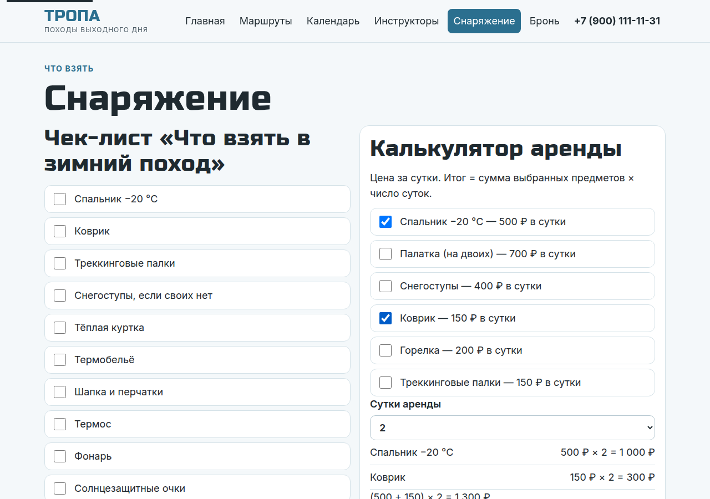
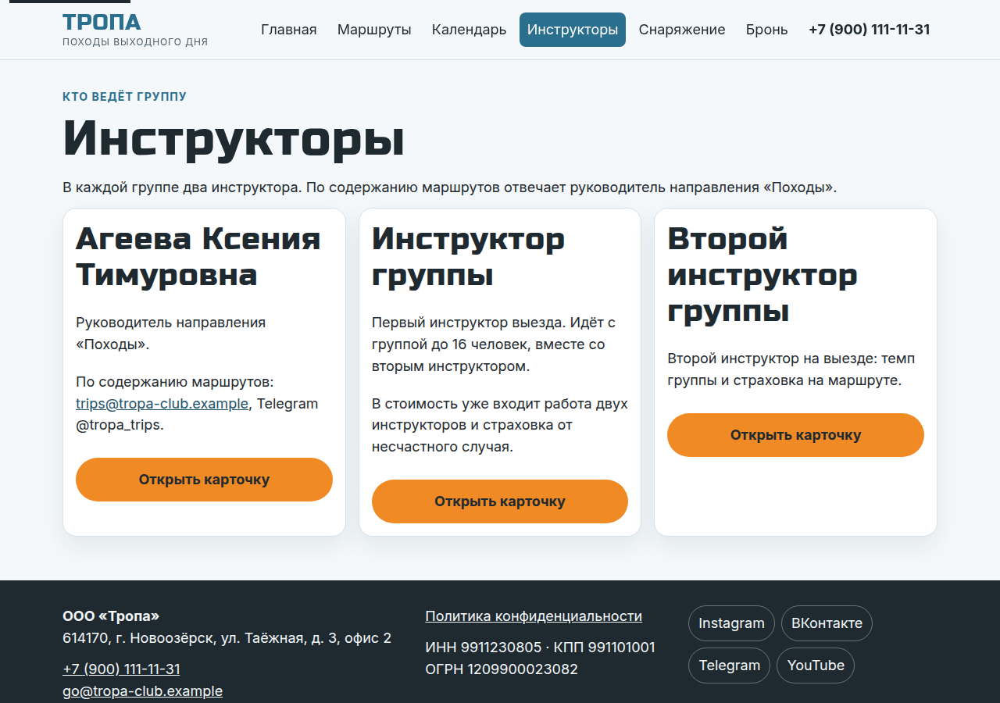
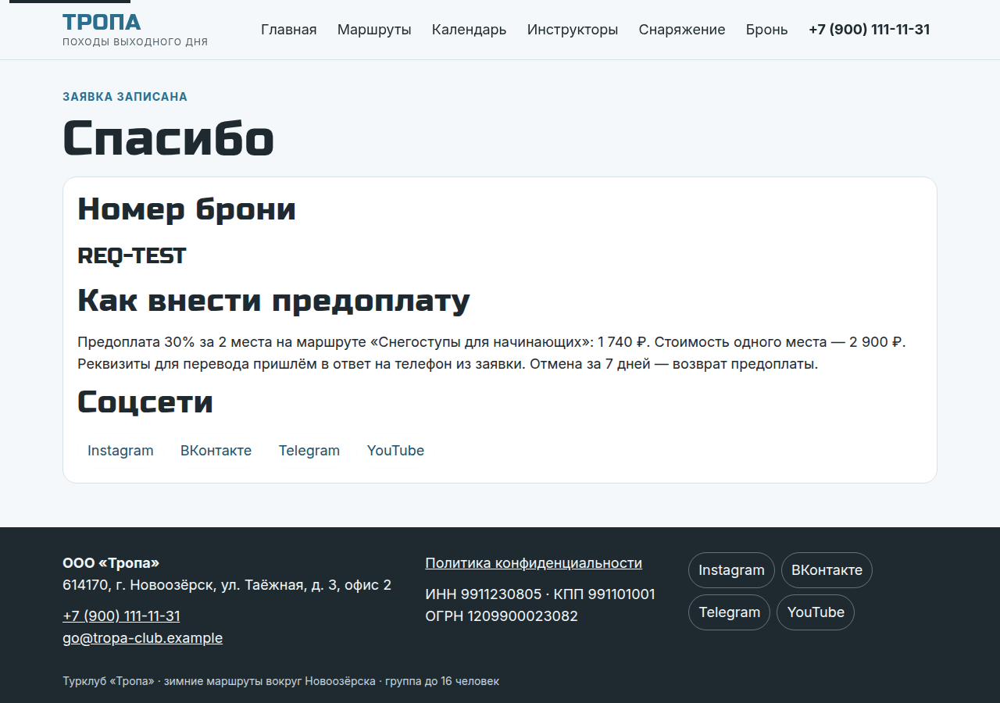

# Описание работы · ТЗ № ТЗ-11/2026 · «Тропа»

**Исполнитель:** Марущак Сергей Григорьевич, группа РПО25/2
**Сайт:** адрес Vercel появится после публикации папки `tz-11-turklub-tropa`. Локально страницы открываются как статические HTML.
**Период проверок:** ещё не начат. Кадры GA4, соцсетей и DataLens снимаются после подключения, список — в [chto-snyat.md](chto-snyat.md).

## 1. Задача заказчика

Компания «Тропа» получает заявки из Instagram и ВКонтакте, но не знает, какой канал приводит людей в поход. Бронь живёт в переписке: инструктор сверяет свою таблицу и отвечает. В сентябре 2026 года 58 человек написали в группы, где мест уже не было, и другую дату им не предложили. Зимой половина вопросов — «Что взять?» и «Можно ли арендовать?». К 1 ноября нужна продажа 6 зимних маршрутов: сайт, календарь, аренда и одна таблица броней с источником и статусом.

## 2. Схема работы

Посетитель приходит из соцсетей или по QR на стойке магазина снаряжения по ссылке с пятью UTM-метками. Сайт на Vercel шлёт события в GA4. Бронь уходит в Google Таблицу «Tropa — Bookings» через Apps Script. Комментарий «СНАРЯГА» или «НОВИЧОК» под Reel ManyChat отвечает кнопкой на нужную страницу. GA4 и таблица сходятся на дашборде DataLens.

## 3. Сайт

Сайт из 8 страниц и `404.html` собран в Cursor и вычитан по разделу 2 ТЗ: цены, маршруты и условия только из задания. Опубликовать на Vercel нужно вам, обновление пойдёт после push в продовую ветку.

Цвета: синий лёд `#2B6F8F`, оранжевый `#F08A24`, снежный `#F4F8FA`, графит `#1F2A30`. Заголовки — Russo One, текст — Inter. Локальный Lighthouse главной в мобильном режиме: Performance 99, Accessibility 100, SEO 100.

Калькулятор, календарь без мест, фильтр лёгких маршрутов, форма и страница спасибо:

## 4. Аналитика GA4

В коде подготовлено 20 событий: 6 собирает расширенная статистика, 12 своих обязательных и 2 по выбору (`promo_copy`, `map_open`). Ключевые, их отмечают в админке: `generate_lead`, `contact_click`, `messenger_click`. Таблица с файлом и строкой — [events.md](events.md).

Кадров DebugView в репозитории нет: ресурс «ТРОПА — сайт» создаёте вы, затем кладёте снимки в `screens/ga4/`. Сейчас в `<head>` стоит учебный ID `G-YQM8LSJ9F7` из домашних работ, для приёмки его заменяют.

## 5. UTM-ссылки и соцсети

В реестре 12 ссылок. Кампания продажи — `winter_trips_2026`, у ветки «НОВИЧОК» — `beginners_dec_2026`. Пятая метка у всех строк — `utm_term=winter`. Пустые ячейки ТЗ заполнены так: Stories — `stories_01`, фотоотчёт — кампания `winter_trips_2026`, чат участников — `social` и `members_chat`, описание ролика — `video_01`. Ники блогеров пока `partner_one` и `partner_two`: перед постом их меняют на ники одногруппников.

Публикаций в четырёх соцсетях ещё нет, короткие ссылки `vk.cc` или `clck.ru` для U-05…U-08 тоже. QR и афиша для стойки магазина уже собраны: [qr-u-12.png](qr-u-12.png), [afisha.pdf](afisha.pdf).

## 6. Заявки

Форма на `contacts.html` проверяет имя, телефон `+7` и 10 цифр, маршрут, дату со свободными местами, число участников от 1 до 6 и два флажка. Скрытые поля меток заполняет `js/form.js`. Заявка уходит `fetch` на Apps Script. После `{"ok": true}` посетитель попадает на `thanks.html` с номером `REQ-…`, и только тогда уходит `generate_lead`.

Приёмник в `apps-script/Code.gs` повторяет `doPost` темы 7: блокировка, проверка заголовков, отказ на повтор `request_id`, `created_at` и статус `new` ставит сервер. Листы готовит функция `setupWorkbook`. Таблицу создаёте вы, поэтому кадра строки в `leads` ещё нет. Кадр формы и ошибки поля уже есть выше.

## 7. Автоответы в Instagram

Тексты двух веток записаны в [podklyuchenie.md](podklyuchenie.md). Слово «СНАРЯГА» ведёт на чек-лист, ссылка U-02. Слово «НОВИЧОК» ведёт на лёгкие маршруты, ссылка U-03. Аккаунт, Reel и ManyChat в режиме Live подключаете вы. Кадры комментария и Direct в репозиторий ещё не положены.

## 8. Отчёты и дашборд

Воронка задана пятью шагами: `page_view` → `trip_filter` → `cta_click` → `form_start` → `generate_lead`. Где именно теряются люди, по пустому ресурсу не посчитать. Записка с местами под ваши числа — [report.md](report.md). Дашборд DataLens из трёх вкладок собирается после выгрузки, снимков `screens/datalens/` ещё нет.

## 9. Что получил бизнес

| Было | Стало в продукте |
|---|---|
| бронь в личных сообщениях, место занимает тот, кому ответили | форма пишет строку с маршрутом, датой и числом участников |
| 58 человек не получили другую дату | у выезда без мест есть подпись «Мест нет» и ссылка на другую дату того же маршрута |
| источник клиента неизвестен | у заявки есть source, medium, campaign и content |
| «Что взять?» отвечают вручную | чек-лист, PDF и калькулятор аренды, промокод SNOW300 |
| ответы на комментарии вручную | тексты ManyChat готовы, автоматизацию включаете вы |

Рекомендация заказчику по данным отчётов появится после периода проверок. По письму директора уже сделано другое: человек видит замену даты сам, не дожидаясь инструктора.

## 10. Итог

Не получилось: из этой среды нет доступа к вашему GA4, Google Таблице, Vercel, Instagram и DataLens. Поэтому нет кадров DebugView, публикаций, строки заявки и чисел в записке.

ИИ использовался для: страниц, текстов по разделу 2, кода аналитики и приёмника, схемы, реестра и черновика слайдов. Запросы — в [prompts.md](prompts.md).
